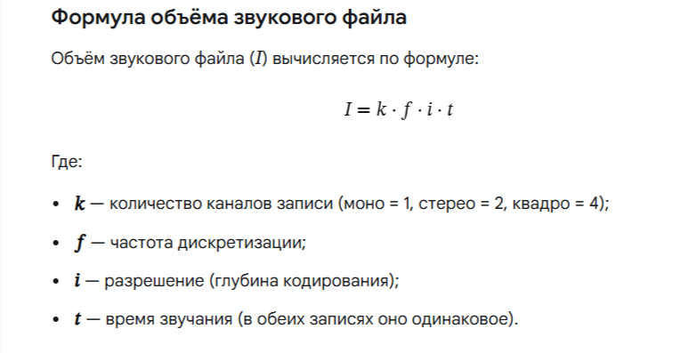

# Логические операции в ЕГЭ / КЕГЭ по информатике (Задание 2)

## Таблица логических операций

| Название операции | Знаки в КЕГЭ | В Python | Когда истинна (равна 1) |
| :--- | :---: | :---: | :--- |
| **Отрицание** (НЕ, инверсия) | \(\neg\), \(\overline{x}\) | `not` | Когда исходное выражение ложно (0) |
| **Конъюнкция** (И, логическое умножение) | \(\wedge\), \(\cdot\), \(\&\) | `and` | Только когда **оба** операнда равны 1 |
| **Дизъюнкция** (ИЛИ, логическое сложение) | \(\vee\), \(+\) | `or` | Когда **хотя бы один** операнд равен 1 |
| **Импликация** (Следование) | \(\to\) | `<=` | Всегда, кроме случая \(1 \to 0\) |
| **Эквивалентность** (Тождество) | \(\equiv\), \(\leftrightarrow\) | `==` | Когда оба операнда **одинаковы** |
| **Строгая дизъюнкция** (Исключающее ИЛИ) | \(\oplus\), \(\neq\) | `!=` | Когда операнды **различаются** |

---

## Приоритет выполнения действий (без скобок)

1. Выражения в **скобках**
2. **Отрицание** (\(\neg\))
3. **Конъюнкция** (\(\wedge\))
4. **Дизъюнкция** (\(\vee\))
5. **Импликация** (\(\to\))
6. **Эквивалентность** (\(\equiv\))

---

## Шаблон кода на Python для генерации таблицы истинности

Для решения задания №2 проще всего использовать метод перебора всех возможных значений переменных `x`, `y`, `z`, `w`:

```python
print("w x y z | F")  # Заголовок таблицы
for w in range(2):
    for x in range(2):
        for y in range(2):
            for z in range(2):
                # Сюда записывается функция из условия задачи
                # Пример для выражения: ((z == x) <= (w and z)) <= ((not y and z) <= y)
                f = ((z == x) <= (w and z)) <= ((not y and z) <= y)
                
                # Если в таблице КЕГЭ функция равна 0, пишем: if f == 0:
                # Если функция равна 1, пишем: if f == 1: (или просто if f:)
                print(f"{w} {x} {y} {z} | {int(f)}")
```

# Таблицы истинности логических операторов

В таблицах ниже используются следующие обозначения:
* `0` — Ложь (False)
* `1` — Истина (True)

---

## 1. Отрицание (НЕ / Инверсия / NOT)
* Обозначения: `¬x`, `x̄`, `not x`
* Меняет значение переменной на противоположное.

| A | ¬A |
| :-: | :-: |
| 0 | 1 |
| 1 | 0 |

---

## 2. Конъюнкция (И / Логическое умножение / AND)
* Обозначения: `A ∧ B`, `A · B`, `A & B`, `A and B`
* Истинна только тогда, когда **оба** выражения истинны.

| A | B | A ∧ B |
| :-: | :-: | :-: |
| 0 | 0 | 0 |
| 0 | 1 | 0 |
| 1 | 0 | 0 |
| 1 | 1 | 1 |

---

## 3. Дизъюнкция (ИЛИ / Логическое сложение / OR)
* Обозначения: `A ∨ B`, `A + B`, `A || B`, `A or B`
* Истинна, если истинно **хотя бы одно** из выражений.

| A | B | A ∨ B |
| :-: | :-: | :-: |
| 0 | 0 | 0 |
| 0 | 1 | 1 |
| 1 | 0 | 1 |
| 1 | 1 | 1 |

---

## 4. Импликация (Следование / IF-THEN)
* Обозначения: `A → B`, `A <= B` (в Python)
* Ложна **только в одном случае**: когда из истины (`1`) следует ложь (`0`).

| A | B | A → B |
| :-: | :-: | :-: |
| 0 | 0 | 1 |
| 0 | 1 | 1 |
| 1 | 0 | 0 |
| 1 | 1 | 1 |

---

## 5. Эквивалентность (Тождество / Равенство / EQUAL)
* Обозначения: `A ≡ B`, `A ↔ B`, `A == B` (в Python)
* Истинна, когда оба операнда **одинаковы** (оба ложны или оба истинны).

| A | B | A ≡ B |
| :-: | :-: | :-: |
| 0 | 0 | 1 |
| 0 | 1 | 0 |
| 1 | 0 | 0 |
| 1 | 1 | 1 |

---

## 6. Строгая дизъюнкция (Исключающее ИЛИ / XOR)
* Обозначения: `A ⊕ B`, `A ≠ B`, `A != B` (в Python)
* Истинна, когда операнды **различаются** (ровно один из них равен `1`).

| A | B | A ⊕ B |
| :-: | :-: | :-: |
| 0 | 0 | 0 |
| 0 | 1 | 1 |
| 1 | 0 | 1 |
| 1 | 1 | 0 |

---

## 7. Штрих Шеффера (И-НЕ / NAND)
* Обозначения: `A | B`
* Противоположна конъюнкции (ложна только когда оба равны `1`).

| A | B | A \| B |
| :-: | :-: | :-: |
| 0 | 0 | 1 |
| 0 | 1 | 1 |
| 1 | 0 | 1 |
| 1 | 1 | 0 |

---

## 8. Стрелка Пирса (ИЛИ-НЕ / NOR)
* Обозначения: `A ↓ B`
* Противоположна дизъюнкции (истинна только когда оба равны `0`).

| A | B | A ↓ B |
| :-: | :-: | :-: |
| 0 | 0 | 1 |
| 0 | 1 | 0 |
| 1 | 0 | 0 |
| 1 | 1 | 0 |


Два закона Де Моргана

- Закон 1: Отрицание конъюнкции (И)
	• Формула: НЕ (А И В) = (НЕ А) ИЛИ (НЕ В)
	• Суть: Отрицание логического произведения равно сумме отрицаний.
	• Пример из жизни: Выражение «Неверно, что я взял и ключи, и телефон» означает то же самое, что «Я не взял ключи ИЛИ я не взял телефон» (хотя бы чего-то одного у меня с собой нет).
- Закон 2: Отрицание дизъюнкции (ИЛИ)
	• Формула: НЕ (А ИЛИ В) = (НЕ А) И (НЕ В)
	• Суть: Отрицание логической суммы равно произведению отрицаний.
	• Пример из жизни: Выражение «Неверно, что на улице идет дождь или снег» означает то же самое, что «На улице нет дождя И на улице нет снега» (нет ни того, ни другого одновременно).

- A → B равносильно НЕ A ИЛИ B (или в знаках: ¬A ∨ B)
- Пример работы импликации - начальник и подчиненный 

## Срезы (slices)


### Шпаргалка по синтаксису срезов: последовательность[старт : стоп : шаг]


- [:3] — взять элементы с самого начала до индекса 3 (не включая его).
- [3:] — взять элементы с индекса 3 и до самого конца.
- [-1] — просто последний элемент (это не срез, а обратный индекс).
- [:-1] — взять всю строку/список, кроме самого последнего элемента. Очень удобно, если нужно отрезать финальный символ.
- [::2] — взять каждый второй элемент (шаг 2).

## №7, Звуковые файлы, вес по формуле


## №8 
from itertools import product

count = 0
# Перебираем все комбинации длиной 5 из восьмеричных цифр
for p in product('01234567', repeat=5):
    num = ''.join(p)
    # Первая цифра не 0, ровно две двойки, и две двойки не стоят подряд
    if num[0] != '0' and num.count('2') == 2 and '22' not in num:
        count += 1

print(count)
